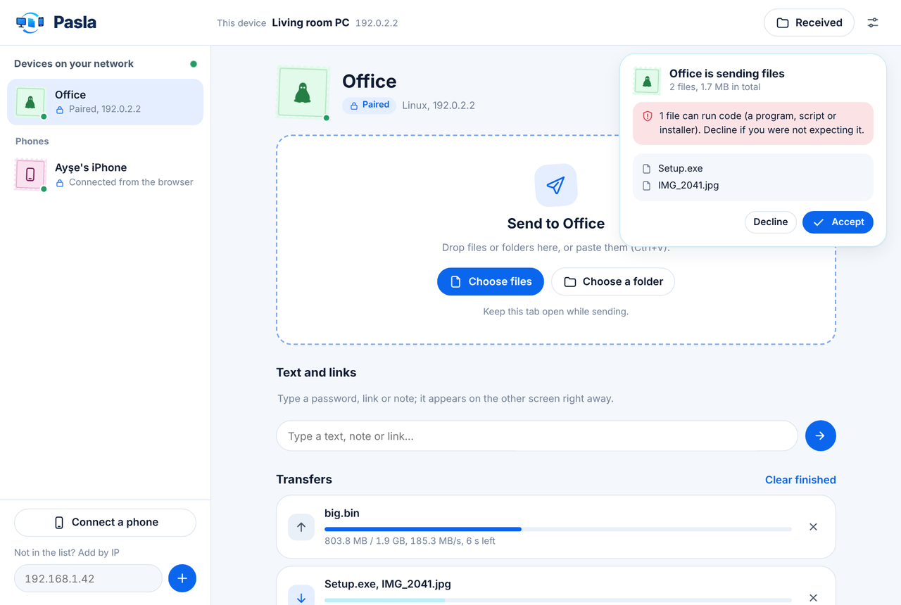
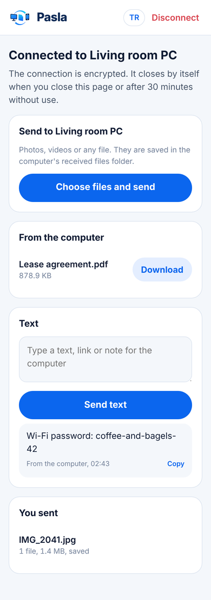

<p align="center">
  <a href="https://github.com/temurcanbulut/pasla/actions/workflows/ci.yml"></a>
  <a href="https://github.com/temurcanbulut/pasla/releases"></a>
  <a href="LICENSE"></a>
</p>

<p align="center">
  <picture>
    <source media="(prefers-color-scheme: dark)" srcset="assets/brand/logo-dark.svg">
    
  </picture>
</p>

<p align="center">
  <b>Share files over your LAN with verified desktop pairing and no phone app.</b><br>
  No account, no cloud, no install. Windows · Linux · any phone browser.<br>
  <a href="https://temurcanbulut.github.io/pasla/">Website</a> · <a href="README.tr.md">Türkçe</a>
</p>

<p align="center">
  
</p>

## Why Pasla?

If you have a few computers on one network, moving files usually means a USB stick, wrestling with network shares, or uploading to the internet just to download it again one metre away. Pasla (Turkish for *"pass it"*) replaces all of that: you pass the file to the machine next to you.

- **Finds your devices by itself.** Computers running Pasla on the same network show up within seconds. Routed networks can add a device by IP.
- **Pair once.** Both screens show the same 6-digit code; if they match, confirm. From then on devices know each other by cryptographic identity, even when IP addresses change.
- **Phones connect without an app.** Scan the QR code the computer shows, confirm a 4-digit number on both screens, and send files and text both ways from the phone's browser. Works on Android and iPhone.
- **Drag, drop, paste.** Files, whole folder trees, screenshots straight from the clipboard. Folder structure is kept and nothing is ever overwritten.
- **Text too.** Send a password, link or note to the other screen, ready to copy.
- **Fast.** Files stream straight to disk. A single large file reached ~150 MB/s in local tests, which is gigabit-network territory.
- **Truly offline.** The interface, fonts and icons are built into the program. Pasla never contacts anything outside your network.
- **English or Turkish.** English by default; switch to Turkish in Settings, or with the EN/TR button on the phone.

## Security at a glance

| Threat | What Pasla does |
|---|---|
| Someone listening on the network | Device-to-device traffic is mutual TLS 1.3; phone traffic is TLS |
| Someone in the middle | Pairing compares a committed 6-digit code; afterwards every connection pins the certificate fingerprint |
| A device posing as another | Identity is the fingerprint, not the name. An unpaired device using a paired device's name is flagged in red |
| Pairing-request spam | A declined device and IP wait 30 s, then exponentially up to 15 min; at most 6 requests per source IP per minute |
| Files you did not want | Every transfer asks first by default. Executables (exe, msi, ps1, bat, sh…) are flagged on the accept card |
| Opening a malicious file on Windows | Received files get the Mark of the Web, like browser downloads, so SmartScreen and Office Protected View step in |
| Writing outside the folder | Incoming names are sanitised (`..`, absolute paths, names Windows forbids); this code is fuzz-tested |
| Filling the disk | Offers that don't fit are refused up front; 256 MB is always left free |
| Other users or programs on the same computer | The local interface needs a session secret. The browser signs in with a one-time, two-minute code; the secret sits in a file only you can read |
| Other websites in your browser | `Host` and `Origin` checks, SameSite=Strict cookies, a strict Content Security Policy |
| Someone who sees the QR code | The phone key expires in 10 minutes, is consumed once, and every phone needs desktop approval; source-IP throttling limits guesses |

Details: [docs/PROTOCOL.md](docs/PROTOCOL.md) (protocol and threat model) · Reporting a vulnerability: [SECURITY.md](SECURITY.md)

## Install

Download the file for your system from [Releases](https://github.com/temurcanbulut/pasla/releases). If your network is offline, carry it over once on a USB stick.

| System | File |
|---|---|
| Windows 10/11 (64-bit) | `pasla-windows-amd64.exe` |
| Windows on ARM | `pasla-windows-arm64.exe` |
| Linux (64-bit) | `pasla-linux-amd64` |
| Linux on ARM (Raspberry Pi 4/5) | `pasla-linux-arm64` |

Check the download against `SHA256SUMS.txt`:

```powershell
Get-FileHash .\pasla-windows-amd64.exe -Algorithm SHA256   # Windows
```
```sh
sha256sum -c SHA256SUMS.txt --ignore-missing               # Linux
```

**Windows:** double-click the file. No console window opens: the interface appears in your browser and a Pasla icon sits in the notification area next to the clock. Click it to reopen the interface; right-click it to quit. The first time, Windows Firewall asks for permission; tick **Private networks** and allow.

> Like any new, unsigned program, Pasla may get a SmartScreen warning or a false positive from some AI-based antivirus engines at first. All the source is in this repository and you can [build it yourself](#build-from-source).

**Linux:**

```sh
chmod +x pasla-linux-amd64
./pasla-linux-amd64
```

The interface opens in your browser. **Closing the Pasla tab or window quits Pasla** (a few seconds later, so a reload is safe; running transfers finish first). If other devices should be able to send you files while the window is closed, turn on **Settings → Keep running after I close the window**; Pasla then stays in the notification area on Windows. You can also quit with **Settings → Quit Pasla**, the tray icon on Windows, or `Ctrl+C` in a terminal. Starting Pasla again while it runs simply reopens the interface. When Pasla has no terminal (double-clicked), it writes its log to `pasla.log` in the settings folder, and shows a message box if it cannot start.

## Use

### Computer to computer

1. Open Pasla on both computers. They appear in each other's list.
2. Click a device and press **Pair**. Both screens show the same code; if it matches, press **Codes match, pair** on both.
3. Drag and drop files or folders. An accept card opens on the other side; the transfer starts as soon as it is accepted.

For devices you use all the time, turn on **Accept files from this device without asking** on the device page. The **safety number** on the same page is identical on both devices, so you can compare it whenever you like.

### Phone to computer

1. On the computer, press **Connect a phone** (bottom left). A QR code appears.
2. Scan it with the phone's camera. If the browser says the connection is not private, tap **Advanced → Proceed** (on iPhone: **Show Details → visit this website**). The connection is still encrypted; the warning appears because your computer made its own certificate.
3. The same 4-digit number appears on the phone and the computer. If it matches, press **Same, allow** on the computer.

The phone can now send files and text to the computer and download what the computer sends it. The phone port is open only while the QR window is open or a phone is connected, and a phone left unused for 30 minutes is disconnected.

<table>
<tr>
<td width="64%"></td>
<td align="center"></td>
</tr>
<tr>
<td></td>
<td></td>
</tr>
</table>

### From the command line

To send many files without keeping a browser open, while Pasla is running:

```sh
pasla send -to "Office" D:\Photos E:\backup.zip
```

`-to` is the name of a paired device or the first characters of its fingerprint. On Windows, run it from cmd or PowerShell; the output appears in that window. The command reads the running Pasla's session secret from your user settings folder, so another user cannot send in your name.

### Flags

| Flag | Default | Meaning |
|---|---|---|
| `-name` | computer name | Name other devices see |
| `-receive-dir` | `Downloads/Pasla` | Folder for incoming files |
| `-port` | `47821` | Transfer port between devices (TCP) |
| `-discovery-port` | `47820` | Automatic discovery port (UDP) |
| `-phone-port` | `47823` | Phone port (TCP, open only when needed) |
| `-ui` | `127.0.0.1:47822` | Interface address |
| `-no-discovery` | off | Turn off broadcasts; add devices by IP |
| `-no-browser` | off | Don't open the browser at start |
| `-config` | user config folder | Where the identity and settings live |

Settings and the device identity live in `%AppData%\pasla` on Windows and `~/.config/pasla` on Linux. The language is stored there too and also applies to the command line.

## Network

| Port | Protocol | Used for |
|---|---|---|
| 47820 | UDP | Automatic discovery (local broadcast) |
| 47821 | TCP | Pairing and transfers |
| 47823 | TCP | Phones (only when needed) |

Windows asks for firewall permission on first start. To add the rule yourself (admin PowerShell):

```powershell
New-NetFirewallRule -DisplayName "Pasla" -Direction Inbound -Program "C:\Tools\pasla.exe" -Profile Private -Action Allow
```

With `ufw` on Linux:

```sh
sudo ufw allow from 192.168.1.0/24 to any port 47820 proto udp
sudo ufw allow from 192.168.1.0/24 to any port 47821,47823 proto tcp
```

Routers don't forward broadcasts between subnets. For devices on another subnet, add them by IP once; after pairing, Pasla looks for them at their last known address.

## Build from source

Go 1.27.3 or newer; nothing else. Everything, the QR encoder included, uses only the standard library.

```sh
git clone https://github.com/temurcanbulut/pasla.git
cd pasla
make build          # ./dist/pasla
make release        # all Windows and Linux binaries + SHA256SUMS.txt
make test           # tests with the race detector
make fuzz           # 60 s of fuzzing on the file-name sanitiser
```

Without make, build for Linux with `go build -trimpath -ldflags "-s -w" -o pasla ./cmd/pasla`, or for Windows with `go build -trimpath -ldflags "-s -w -H windowsgui" -o pasla.exe ./cmd/pasla`.

> When you fork, replace the repository owner everywhere (module path, links, website): `grep -rlI temurcanbulut . --exclude-dir=.git | xargs sed -i 's#temurcanbulut#YOU#g'`.

### Translations

English is the source language. Texts the Go code produces live in [`internal/i18n`](internal/i18n), texts of the pages in [`internal/ui/static/i18n.js`](internal/ui/static/i18n.js). Tests fail if any text is missing a Turkish translation. To add a language, add a dictionary in both places and an entry to `LANGS`.

### Layout

```
cmd/pasla/           command line: start and `pasla send`; Windows icon and version info
internal/node/       the core
  identity.go        device certificate and fingerprint
  discovery.go       UDP discovery, adding by IP
  pairing.go         numeric-comparison pairing
  pairguard.go       rate limits for pairing requests
  transfer.go        offer/accept, streaming transfers, text messages
  phone.go           phone portal (HTTPS, QR, approval)
  auth.go            local interface session
  safety.go          safety number, risky file types
  paths.go           file-name sanitising, collision-free destinations
  motw_windows.go    Mark of the Web on received files
internal/i18n/       translations for Go messages
internal/qr/         dependency-free QR encoder
internal/ui/static/  desktop and phone pages (no build step)
assets/brand/        logo, icon and their generator (see docs/BRAND.md)
site/                the project website (GitHub Pages, English and Turkish)
tools/winres/        writes the Windows icon, version info and manifest (.syso)
```

## Roadmap

- [x] Encrypted transfers and pairing between computers
- [x] Phones from the browser (QR)
- [x] English and Turkish
- [x] No console window on Windows; tray icon
- [ ] Resume interrupted transfers
- [ ] Code-signed Windows releases
- [ ] More languages (contributions welcome)

## License

Project documents: [Contributing](CONTRIBUTING.md) · [Changelog](CHANGELOG.md) · [Security policy](SECURITY.md) · [Protocol](docs/PROTOCOL.md).

The website's bundled Inter fonts are licensed under [SIL OFL 1.1](site/fonts/OFL.txt).

[MIT](LICENSE). The logo and icon are under the same license; the letters of the wordmark are outlined from [Inter](https://rsms.me/inter/) (SIL OFL 1.1).
