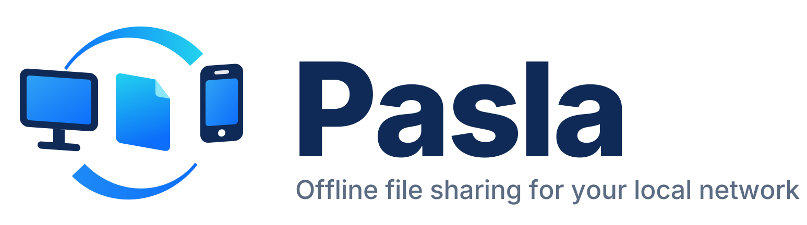
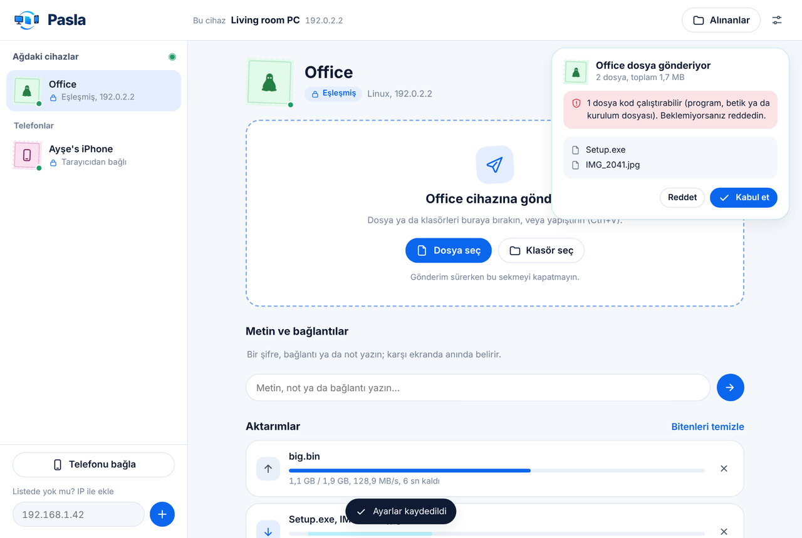
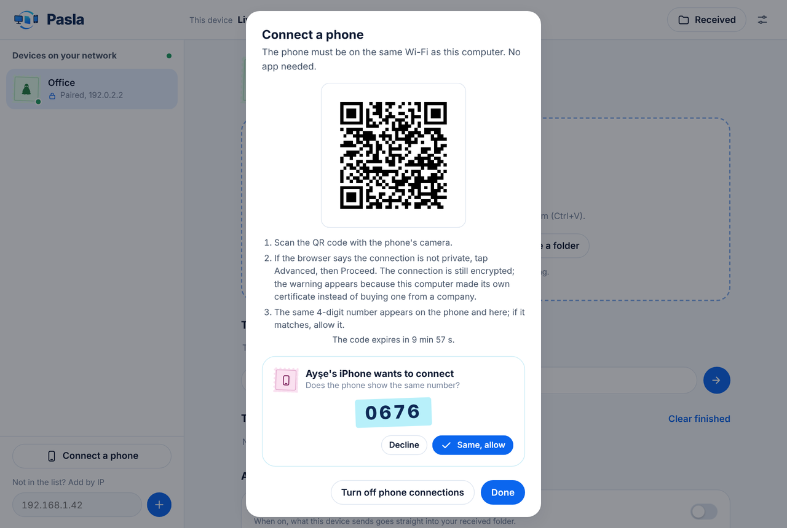
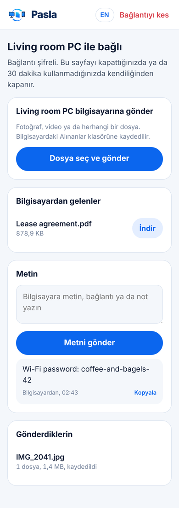
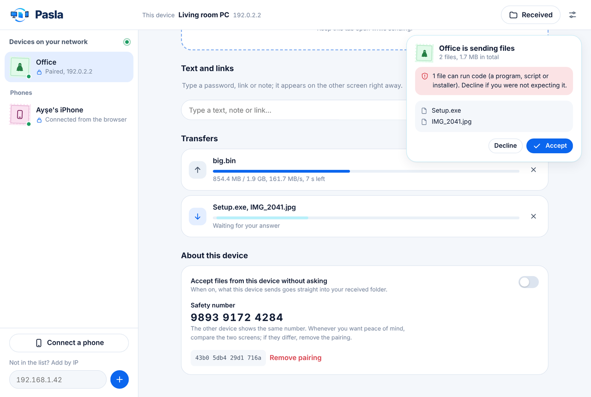
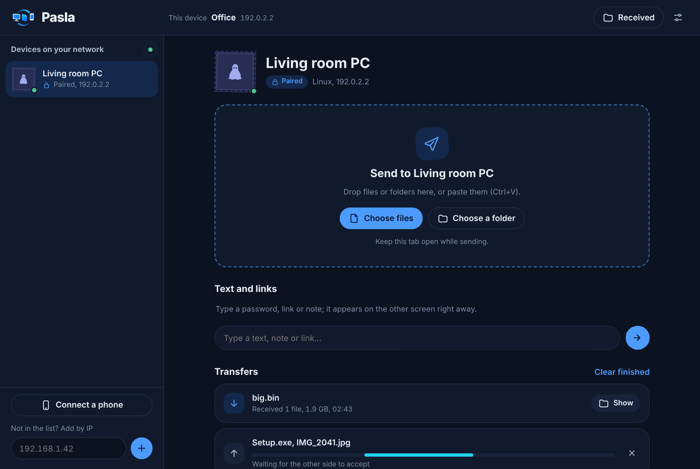

<p align="center">
  <picture>
    <source media="(prefers-color-scheme: dark)" srcset="assets/brand/logo-dark.svg">
    
  </picture>
</p>

<p align="center">
  <b>Doğrulanabilir masaüstü eşleşmesiyle yerel ağda dosya paylaş; telefona uygulama kurma.</b><br>
  Tek dosya. Kurulum, hesap ve bulut yok. Windows · Linux · her telefon tarayıcısı.<br>
  <a href="https://temurcanbulut.github.io/pasla/?lang=tr">Web sitesi</a> · <a href="README.md">English</a>
</p>

<p align="center">
  
</p>

## Neden Pasla?

Aynı ağda birkaç bilgisayarınız varsa dosya taşımak genelde USB bellek, uğraştıran ağ paylaşımı ayarları ya da dosyayı internete yükleyip geri indirmek demektir. Pasla bunların yerine geçer: dosyayı yandaki makineye **pas verirsiniz**.

- **Kendiliğinden bulur.** Aynı ağda Pasla açık olan bilgisayarlar birkaç saniyede listede belirir. Yayının ulaşmadığı yerler için IP ile ekleme var.
- **Bir kez eşleştirilir.** İki ekranda aynı 6 haneli kod çıkar, aynıysa onaylanır. Sonrasında cihazlar birbirini kriptografik kimliğinden tanır, IP değişse de.
- **Telefon da bağlanır, uygulama gerekmez.** Bilgisayarın gösterdiği QR kodu okutursunuz, iki ekranda aynı 4 haneli numarayı onaylarsınız; telefonla bilgisayar arasında iki yönlü dosya ve metin gider. Android'de de iPhone'da da çalışır.
- **Sürükle, bırak, yapıştır.** Dosyalar, klasör ağaçları, panodaki ekran görüntüleri. Klasör yapısı korunur, hiçbir dosyanın üzerine yazılmaz.
- **Metin de gider.** Bir şifreyi, bağlantıyı ya da notu tek tıkla kopyalanabilir biçimde öbür ekrana yollayın.
- **Hızlı.** Dosyalar parça parça diske akar, belleğe yığılmaz. Yerel ölçümde tek dosyada ~150 MB/sn; gigabit bir ağın sınırına dayanır.
- **Tamamen çevrimdışı.** Arayüz, fontlar ve simgeler dahil her şey programın içine gömülü. Hiçbir dış adrese istek atılmaz.
- **İngilizce ya da Türkçe.** Varsayılan dil İngilizce. Türkçeye geçmek için bilgisayarda **Settings → Language → Türkçe**, telefonda sağ üstteki **TR** düğmesi.

## Güvenlik bir bakışta

| Tehdit | Önlem |
|---|---|
| Ağı dinleyen biri | Cihazlar arası trafik karşılıklı TLS 1.3, telefon trafiği TLS ile şifreli |
| Masaüstü eşleşmesinde araya girme (MITM) | Eşleştirmede taahhütlü 6 haneli kod karşılaştırması; sonra her bağlantıda sertifika parmak izi sabitleme |
| Başka bir cihazın kılığına girme | Kimlik isimle değil, parmak iziyle belirlenir. Eşleşmiş bir cihazın adını taşıyan yabancı cihaz kırmızıyla işaretlenir |
| Sürekli eşleştirme isteğiyle taciz | Reddedilen cihaz ve IP önce 30 sn, sonra katlanarak 15 dk'ya kadar bekletilir; kaynak IP başına dakikada en fazla 6 istek |
| İstenmeyen dosya | Varsayılan olarak her gönderim onay ister. Çalıştırılabilir dosyalar (exe, msi, ps1, bat, sh…) kabul ekranında uyarıyla gösterilir |
| Windows'ta zararlı dosyayı açma | Gelen dosyalara tarayıcıların indirmelere eklediği "Web işareti" (Mark of the Web) eklenir; SmartScreen ve Office Korumalı Görünüm devreye girer |
| Dizin dışına yazma | Gelen dosya adları temizlenir (`..`, mutlak yollar, Windows'a yasak adlar). Bu kod fuzz testinden geçirilir |
| Diskin dolması | Alıcıda yer yoksa gönderim baştan reddedilir; diskte her zaman 256 MB boş bırakılır |
| Aynı bilgisayardaki başka kullanıcı ya da program | Yerel arayüz bir oturum anahtarı ister. Tarayıcı tek kullanımlık, 2 dakikalık bir kodla oturum açar; anahtar yalnızca sizin okuyabildiğiniz bir dosyadadır |
| Tarayıcıdaki başka bir site | `Host` ve `Origin` denetimi, SameSite=Strict çerezler, sıkı içerik güvenlik politikası (CSP) |
| QR kodu gören biri | Telefon anahtarı 10 dakikada veya ilk başarılı girişte geçersiz olur; tahmin sınırı kaynak IP başınadır. Her telefon bilgisayarda 4 haneli numarayla ayrıca onaylanır |

Daha fazlası: [docs/PROTOCOL.tr.md](docs/PROTOCOL.tr.md) · Açık bildirmek için: [SECURITY.tr.md](SECURITY.tr.md)

## Kurulum

[Sürümler](https://github.com/temurcanbulut/pasla/releases) sayfasından işletim sisteminize uygun dosyayı indirin. Ağınız internete kapalıysa dosyayı bir kez USB bellekle taşımanız yeterli.

| Sistem | Dosya |
|---|---|
| Windows 10/11 (64 bit) | `pasla-windows-amd64.exe` |
| Windows (ARM) | `pasla-windows-arm64.exe` |
| Linux (64 bit) | `pasla-linux-amd64` |
| Linux (ARM, Raspberry Pi 4/5) | `pasla-linux-arm64` |

İndirdiğiniz dosyanın değişmediğini doğrulamak için `SHA256SUMS.txt` ile karşılaştırın:

```powershell
# Windows
Get-FileHash .\pasla-windows-amd64.exe -Algorithm SHA256
```
```sh
# Linux
sha256sum -c SHA256SUMS.txt --ignore-missing
```

**Windows:** Dosyaya çift tıklayın. Siyah konsol penceresi açılmaz: arayüz tarayıcıda görünür, saatin yanındaki bildirim alanında da bir Pasla simgesi belirir. Simgeye tıklayınca arayüz yeniden açılır, sağ tıklayınca kapatabilirsiniz. İlk açılışta güvenlik duvarı izin soracaktır; **Özel ağlar** kutusunu işaretleyip izin verin.

> Windows imzasız ikililer için uyarı gösterebilir. Çalıştırmadan önce açık kaynağı ve yayın kökenini inceleyin; özetler baytları doğrular. İsterseniz [kaynaktan derleyebilirsiniz](#kaynaktan-derleme).

**Linux:**

```sh
chmod +x pasla-linux-amd64
./pasla-linux-amd64
```

Arayüz tarayıcıda kendiliğinden açılır. **Pasla sekmesini ya da penceresini kapatınca Pasla da kapanır** (birkaç saniye sonra; sayfayı yenilemek sorun olmaz, süren aktarımlar önce biter). Pencere kapalıyken de başka cihazlar size dosya gönderebilsin istiyorsanız **Ayarlar → Pencereyi kapatınca da çalışmaya devam etsin**'i açın; Pasla o zaman Windows'ta saatin yanında kalır. Ayrıca **Ayarlar → Pasla'yı kapat**, Windows'ta bildirim alanındaki simge ya da terminalde `Ctrl+C` ile de kapatabilirsiniz. Program çalışırken yeniden başlatırsanız yalnızca arayüzü yeniden açar. Çift tıklayarak başlatıldığında kayıtlarını ayar klasöründeki `pasla.log` dosyasına yazar; başlayamazsa nedenini bir uyarı kutusunda gösterir.

## Kullanım

Aşağıdaki düğme adları Türkçe arayüze göredir. Arayüz ilk açılışta İngilizcedir; **Settings → Language → Türkçe** ile değiştirebilirsiniz.

### Bilgisayardan bilgisayara

1. Pasla'yı iki bilgisayarda da açın. Birbirlerini soldaki listede görürler.
2. Bir cihaza tıklayıp **Eşleştir**'e basın. İki ekranda aynı kod görünür; aynıysa iki tarafta da **Kodlar aynı, eşleştir** deyin.
3. Dosya ya da klasörleri sürükleyip bırakın. Karşı tarafta bir kabul kartı açılır; kabul edildiği anda aktarım başlar.

Sık kullandığınız cihazlar için cihaz sayfasındaki **Bu cihazdan gelenleri sormadan kabul et** anahtarını açabilirsiniz. Aynı sayfadaki **güvenlik numarası** iki cihazda da aynıdır; içiniz rahat etmek istediğinizde karşılaştırabilirsiniz.

### Telefondan bilgisayara

1. Bilgisayarda sol alttaki **Telefonu bağla**'ya basın. Bir QR kod çıkar.
2. Telefonun kamerasıyla okutun. Tarayıcı "bağlantınız gizli değil" derse **Gelişmiş → Devam et**'e dokunun (iPhone'da: **Ayrıntıları Göster → bu web sitesini ziyaret et**). Bağlantı yine şifrelidir; uyarı, sertifikayı bir şirket yerine bilgisayarınızın kendisinin üretmesinden kaynaklanır.
3. Telefonda ve bilgisayarda aynı 4 haneli numara çıkar. Aynıysa bilgisayarda **Aynı, izin ver**'e basın.

Telefon artık bilgisayara dosya ve metin gönderebilir, bilgisayarın gönderdiklerini indirebilir. Telefon bağlantı noktası yalnızca QR penceresi açıkken ya da bir telefon bağlıyken açık durur. 30 dakika kullanılmayan telefonun bağlantısı kendiliğinden kapanır.

<table>
<tr>
<td width="64%"></td>
<td align="center"></td>
</tr>
<tr>
<td></td>
<td></td>
</tr>
</table>

### Komut satırından gönderim

Çok sayıda dosyayı tarayıcıyı açık tutmadan göndermek için, Pasla çalışırken ikinci bir terminalden:

```sh
pasla send -to "Çalışma Odası" D:\Fotoğraflar E:\yedek.zip
```

`-to` değeri eşleşmiş cihazın adı ya da parmak izinin ilk birkaç karakteridir. Windows'ta komutu cmd ya da PowerShell'den çalıştırın; çıktı o pencerede görünür. Komut, çalışan Pasla'nın oturum anahtarını kullanıcı ayar klasöründen okur; başka bir kullanıcı bu komutla sizin adınıza gönderim yapamaz.

### Başlatma seçenekleri

| Bayrak | Varsayılan | Açıklama |
|---|---|---|
| `-name` | bilgisayar adı | Diğer cihazların göreceği ad |
| `-receive-dir` | `İndirilenler/Pasla` | Gelen dosyaların klasörü |
| `-port` | `47821` | Cihazlar arası aktarım portu (TCP) |
| `-discovery-port` | `47820` | Otomatik keşif portu (UDP) |
| `-phone-port` | `47823` | Telefon bağlantısı portu (TCP, yalnızca gerektiğinde açık) |
| `-ui` | `127.0.0.1:47822` | Arayüz adresi |
| `-no-discovery` | kapalı | Yayınları kapatır; cihazlar IP ile eklenir |
| `-no-browser` | kapalı | Başlangıçta tarayıcıyı açmaz |
| `-config` | kullanıcı ayar klasörü | Kimlik ve ayarların tutulduğu klasör |

Ayarlar ve cihaz kimliği Windows'ta `%AppData%\pasla`, Linux'ta `~/.config/pasla` altında durur. Seçtiğiniz dil de burada saklanır ve komut satırına da uygulanır.

## Ağ gereksinimleri

| Port | Protokol | Ne için |
|---|---|---|
| 47820 | UDP | Otomatik keşif (yerel yayın) |
| 47821 | TCP | Eşleştirme ve aktarım |
| 47823 | TCP | Telefon bağlantısı (yalnızca gerektiğinde) |

Windows'ta güvenlik duvarı izni ilk açılışta sorulur. Elle eklemek isterseniz (yönetici PowerShell'de):

```powershell
New-NetFirewallRule -DisplayName "Pasla" -Direction Inbound -Program "C:\Araclar\pasla.exe" -Profile Private -Action Allow
```

Linux'ta `ufw` kullanıyorsanız:

```sh
sudo ufw allow from 192.168.1.0/24 to any port 47820 proto udp
sudo ufw allow from 192.168.1.0/24 to any port 47821,47823 proto tcp
```

Yönlendiriciler UDP yayınlarını alt ağlar arasında taşımaz. Cihazlar farklı alt ağlardaysa sol alttaki kutudan IP ile ekleyin; eşleştikten sonra Pasla onları son bilinen adreslerinde kendisi arar.

## Kaynaktan derleme

Go 1.27.3 veya üstü gerekir; başka bağımlılık yoktur (QR kodlayıcı dahil her şey standart kütüphaneyle yazıldı).

```sh
git clone https://github.com/temurcanbulut/pasla.git
cd pasla
make build          # ./dist/pasla
make release        # Windows ve Linux için tüm ikililer + SHA256SUMS.txt
make test           # yarış denetimiyle testler
make fuzz           # dosya adı temizleyicisini 60 sn fuzz testine sokar
```

Make yoksa Linux için `go build -trimpath -ldflags "-s -w" -o pasla ./cmd/pasla`, Windows için `go build -trimpath -ldflags "-s -w -H windowsgui" -o pasla.exe ./cmd/pasla` komutunu kullanın.

> Depoyu kendi hesabınıza taşırken depo sahibini her yerde (modül yolu, bağlantılar, web sitesi) değiştirin: `grep -rlI temurcanbulut . --exclude-dir=.git | xargs sed -i 's#temurcanbulut#KULLANICI#g'`.

### Çeviriler

Kaynak dil İngilizcedir. Go kodunun ürettiği mesajlar [`internal/i18n`](internal/i18n), sayfaların metinleri [`internal/ui/static/i18n.js`](internal/ui/static/i18n.js) içindedir. Türkçe karşılığı eksik bir metin olursa testler başarısız olur. Yeni bir dil eklemek için iki yere de bir sözlük, `LANGS` listesine de bir satır ekleyin.

### Proje yapısı

```
cmd/pasla/           komut satırı: başlatma ve `pasla send`; Windows simgesi ve sürüm bilgisi
internal/node/       çekirdek
  identity.go        cihaz sertifikası ve parmak izi
  discovery.go       UDP yayınıyla keşif, IP ile ekleme
  pairing.go         sayısal karşılaştırmalı eşleştirme
  pairguard.go       eşleştirme isteklerine hız sınırı
  transfer.go        teklif/kabul, akışlı aktarım, metin mesajları
  phone.go           telefon portalı (HTTPS, QR, onay)
  auth.go            yerel arayüz oturumu
  safety.go          güvenlik numarası, riskli dosya türleri
  paths.go           dosya adı temizleme, çakışmasız hedef seçimi
  motw_windows.go    gelen dosyalara "Web işareti"
internal/i18n/       Go mesajlarının çevirileri
internal/qr/         bağımlılıksız QR kodlayıcı
internal/ui/static/  masaüstü ve telefon arayüzleri (derleme adımı yok)
site/                proje web sitesi (GitHub Pages, İngilizce ve Türkçe)
assets/brand/        logo, simge ve üreticisi (bkz. docs/BRAND.md)
tools/winres/        Windows simgesi, sürüm bilgisi ve manifest (.syso) üretici
```

## Yol haritası

- [x] Bilgisayarlar arası şifreli aktarım ve eşleştirme
- [x] Tarayıcıdan telefon bağlantısı (QR)
- [x] İngilizce ve Türkçe
- [x] Windows'ta konsol penceresi yok; bildirim alanı simgesi
- [ ] Yarıda kalan aktarımı kaldığı yerden sürdürme
- [ ] Kod imzalı Windows sürümleri
- [ ] Yeni diller (katkılara açık)

## Lisans

Proje belgeleri: [Katkı](CONTRIBUTING.tr.md) · [Değişiklikler](CHANGELOG.tr.md) · [Güvenlik politikası](SECURITY.tr.md) · [Protokol](docs/PROTOCOL.tr.md).

Web sitesinde bulunan Inter yazı tipleri [SIL OFL 1.1](site/fonts/OFL.txt) lisanslıdır.

[MIT](LICENSE). Logo ve simge de aynı lisansla kullanılabilir; yazılı logodaki harfler [Inter](https://rsms.me/inter/) (SIL OFL 1.1) yazı tipinden çizgiye dönüştürülmüştür.
